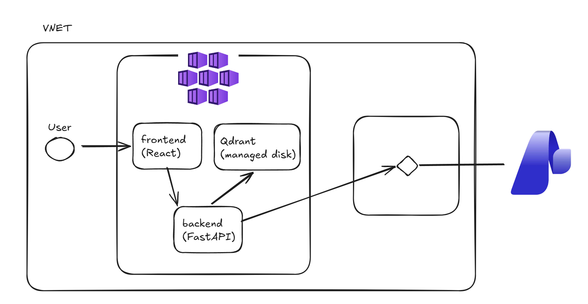

# RaaS

RaaS (RAG as a Service) is a retrieval-augmented question-answering application for plain-text
documents. Upload a UTF-8 `.txt` or `.md` file, store its embeddings in Qdrant,
and ask questions answered with Azure AI Foundry. The React frontend displays
the generated answer and the source passages used to produce it.

## Architecture



The backend chunks uploaded text, creates 384-dimensional embeddings with
`BAAI/bge-small-en-v1.5`, and stores them in the `documents` Qdrant collection.
Queries retrieve the most relevant chunks and pass them to the configured Azure
OpenAI deployment to generate an answer.

## Repository layout

| Path | Description |
| --- | --- |
| [`backend/`](./backend) | FastAPI API, ingestion and retrieval logic, and Python tests |
| [`frontend/app_frontend/`](./frontend/app_frontend) | React and TypeScript single-page application |
| [`frontend/Dockerfile`](./frontend/Dockerfile) | Multi-stage frontend image served by Nginx |
| [`backend/Dockerfile`](./backend/Dockerfile) | FastAPI container image |
| [`helm/raas/`](./helm/raas) | Helm chart for the frontend, API, and Qdrant |
| [`terraform/`](./terraform) | Azure infrastructure and workload identity configuration |
| [`.github/workflows/`](./.github/workflows) | Test, image build, Terraform, and deployment workflows |

## Prerequisites

- Python 3.14
- Node.js 20 or newer and npm
- Docker, if running Qdrant locally

## Local development

### 1. Start Qdrant

```sh
docker run --rm -p 6333:6333 qdrant/qdrant:v1.13.2
```

### 2. Start the backend

From the repository root:

```sh
az login
python3.14 -m venv .venv
source .venv/bin/activate
pip install -r backend/requirements.txt

export AZURE_OPENAI_ENDPOINT="https://<your-foundry-endpoint>/openai/v1/"
export AZURE_OPENAI_DEPLOYMENT="gpt-5.4-mini"

cd backend
uvicorn app_backend.main:app --reload
```

The API listens on `http://127.0.0.1:8000`. Azure authentication uses the
standard Azure identity chain; `az login` is sufficient for local development.

### 3. Start the frontend

In a second terminal:

```sh
cd frontend/app_frontend
npm ci
npm run dev
```

Open the URL printed by Vite. Its development proxy forwards `/ingest` and
`/query` to the backend.

## Configuration

The backend reads these environment variables:

| Variable | Default | Description |
| --- | --- | --- |
| `AZURE_OPENAI_ENDPOINT` | empty | Azure AI Foundry OpenAI-compatible endpoint |
| `AZURE_OPENAI_DEPLOYMENT` | `gpt-5.4-mini` | Chat model deployment name |
| `LLM_TIMEOUT` | `300` | LLM request timeout in seconds |
| `QDRANT_URL` | `http://localhost:6333` | Qdrant endpoint |
| `COLLECTION` | `documents` | Qdrant collection name |
| `EMBED_MODEL` | `BAAI/bge-small-en-v1.5` | FastEmbed model |
| `EMBED_DIM` | `384` | Expected embedding dimension |
| `EMBED_BATCH_SIZE` | `64` | Embedding batch size |
| `MAX_UPLOAD_BYTES` | `5242880` | Maximum upload size |
| `CHUNK_SIZE` | `512` | Chunk size used during ingestion |
| `OVERLAP` | `64` | Chunk overlap |

## API

### `GET /healthz`

Returns `{"status":"ok"}` when the process is running.

### `GET /readyz`

Checks that Qdrant is reachable. Returns HTTP 503 when it is unavailable.

### `POST /ingest`

Accepts a multipart form upload:

```sh
curl -F "file=@sample.txt" http://127.0.0.1:8000/ingest
```

Only UTF-8 text is accepted. The response includes the normalized filename and
number of stored chunks.

### `POST /query`

Accepts JSON with a question and optional number of results:

```sh
curl -X POST http://127.0.0.1:8000/query \
  -H 'Content-Type: application/json' \
  -d '{"question":"What does the document say?","top_k":3}'
```

The response contains the generated answer and the source filename, chunk
index, relevance score, and text for each retrieved passage.

## Tests and builds

Run backend tests:

```sh
source .venv/bin/activate
cd backend
pytest -q
```

Run frontend tests and create a production build:

```sh
cd frontend/app_frontend
npm ci
npm test -- --run
npm run build
```

## Containers

Build the images from the repository root:

```sh
docker build -f backend/Dockerfile -t raas-backend .
docker build -f frontend/Dockerfile -t raas-frontend .
```

The backend exposes port `8000`; the frontend image serves the compiled
application on port `80`. The production Nginx configuration proxies
`/ingest` and `/query` to the Kubernetes backend service.

## Azure and Kubernetes deployment

Infrastructure is managed with Terraform and application resources with Helm.
Read the detailed guides before deploying:

- [Terraform setup](./terraform/README.md), including importing the existing
  Foundry account and model deployment
- [Helm deployment](./helm/raas/README.md), including required GitHub variables
  and secrets

The deployment uses an AKS cluster, a Qdrant StatefulSet with persistent
storage, and Azure Workload Identity for the backend's user-assigned identity.
The application namespace is `raas`.

On pushes to `main`, the deployment workflow runs backend and frontend tests,
builds commit-tagged images, pushes them to Docker Hub, and deploys the Helm
release. Terraform changes use the separate plan/apply workflow.

## License

No license has been specified for this project.